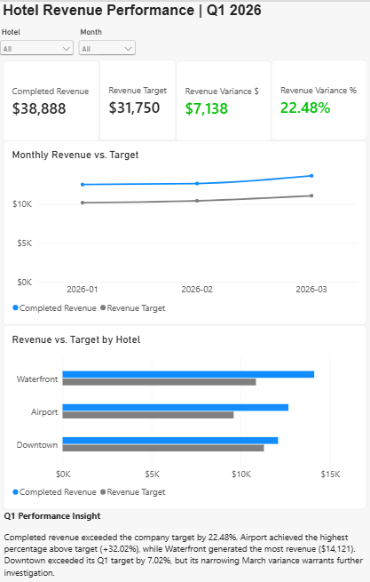
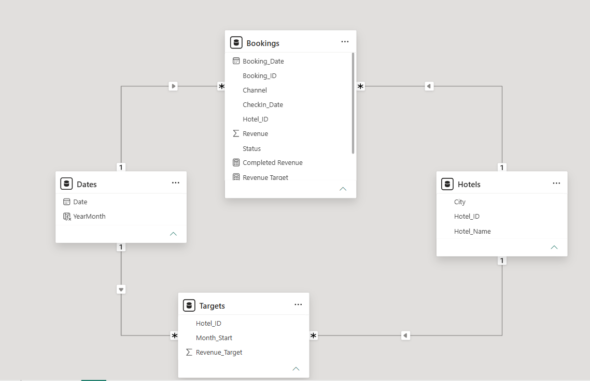

# Hotel Revenue Performance Dashboard | Power BI



## Project overview

**Project type:** Simulated business intelligence case study  
**Tools:** Power BI Desktop, Power Query, DAX, dimensional data modeling  
**Reporting period:** January–March 2026 (Q1)

Built an interactive executive dashboard for a fictional three-hotel group to compare completed-booking revenue against monthly targets, identify performance differences across properties, and guide management follow-up.

> **Data disclaimer:** All data is fictional training data. Findings and recommendations are illustrative, not claims about a real hotel company or operational impact.

## Business questions

- How much completed revenue did the hotel group generate compared with its Q1 target?
- Which hotels contributed the most revenue, and which outperformed target by the highest percentage?
- How did actual revenue compare with targets by month?
- Where should management investigate performance changes?

## Executive findings

| Metric | Q1 2026 |
|---|---:|
| Completed revenue | **$38,888** |
| Revenue target | **$31,750** |
| Dollar variance | **+$7,138** |
| Percentage variance | **+22.48%** |

| Hotel | Completed revenue | Revenue target | Variance | Variance % |
|---|---:|---:|---:|---:|
| Downtown | $12,093 | $11,300 | +$793 | +7.02% |
| Airport | $12,674 | $9,600 | +$3,074 | +32.02% |
| Waterfront | $14,121 | $10,850 | +$3,271 | +30.15% |

**Key takeaway:** Waterfront generated the highest absolute revenue ($14,121), while Airport led in performance relative to its target (+32.02%). Downtown exceeded its Q1 target by +7.02%, but its monthly variance narrowed from +12.03% in February to +1.70% in March. Downtown revenue declined slightly while its target rose; the dashboard alone cannot establish the operational cause.

**Recommended follow-up:** Investigate Downtown's booking volume, cancellation patterns, average booking value, occupancy, and March target assumptions. These further metrics/data are not established by the current dashboard.

## Dashboard features

- Four KPI cards: completed revenue, revenue target, dollar variance, and percentage variance.
- Monthly actual-versus-target line chart and hotel comparison bar chart.
- Hotel and month slicers that update both fact-table measures.
- A concise executive insight explaining the main findings and caveats.
- Positive/negative-aware variance formatting.

## Data and model

Input data is included in the repository root alongside the Power BI report:

| Source table | Rows | Grain |
|---|---:|---|
| `Bookings.csv` | 72 | One row per booking |
| `Hotels.csv` | 3 | One row per hotel |
| `Targets.csv` | 9 | One row per hotel per month |

The model also contains a calculated `Dates` table spanning 2026 with one row per calendar date. `Bookings` and `Targets` remain **separate fact tables**, filtered by shared `Dates` and `Hotels` dimensions using one-to-many, single-direction relationships.

| Dimension (1) | Fact (*) | Key |
|---|---|---|
| `Hotels` | `Bookings` | `Hotel_ID` |
| `Hotels` | `Targets` | `Hotel_ID` |
| `Dates` | `Bookings` | `Dates[Date]` → `Bookings[CheckIn_Date]` |
| `Dates` | `Targets` | `Dates[Date]` → `Targets[Month_Start]` |



> **Relationship verification:** The project author inspected all four relationships in Power BI Desktop **Manage relationships** on October 27, 2026 and confirmed the column pairs above, active status, one-to-many cardinality, and single-direction filtering. The Model View screenshot additionally shows the relationship layout.

Because targets are monthly amounts keyed to the first of each month, the dashboard intentionally compares **complete months and quarters**, not daily targets. Revenue is grouped by `CheckIn_Date` and filtered to completed bookings.

## DAX measures

```dax
Completed Revenue =
CALCULATE(
    SUM(Bookings[Revenue]),
    Bookings[Status] = "Completed"
)
```

```dax
Revenue Target = SUM(Targets[Revenue_Target])
```

```dax
Revenue Variance $ = [Completed Revenue] - [Revenue Target]
```

```dax
Revenue Variance % =
DIVIDE([Revenue Variance $], [Revenue Target])
```

See [`DAX_and_Validation.md`](DAX_and_Validation.md) for calculation logic, data-quality tests, and the reconciliation method.

## Validation

Reconciled DAX output against the source CSVs: Q1 completed revenue **$38,888**, Q1 targets **$31,750**, variance **+$7,138**, and Downtown February completed revenue **$4,145** against a **$3,700** target. Also tested visual filtering for Airport in February: **$3,860** in completed revenue against **$3,200** target.

## Files and usage

```text
hotel-revenue-performance-dashboard/
├── README.md
├── Hotel_Performance_Dashboard.pbix
├── DAX_and_Validation.md
├── PROJECT_HANDOFF.md
├── Bookings.csv
├── Hotels.csv
├── Targets.csv
├── executive-overview.png
└── power-bi-data-model.png
```

The Power BI Desktop report **is included** as [`Hotel_Performance_Dashboard.pbix`](Hotel_Performance_Dashboard.pbix). Open it with Power BI Desktop. To refresh the model on a different computer, adjust the CSV source paths in Power Query to point to the CSV files in this repository. All four relationship column pairs, directions, cardinalities, and active statuses were verified in Power BI Desktop on October 27, 2026.
